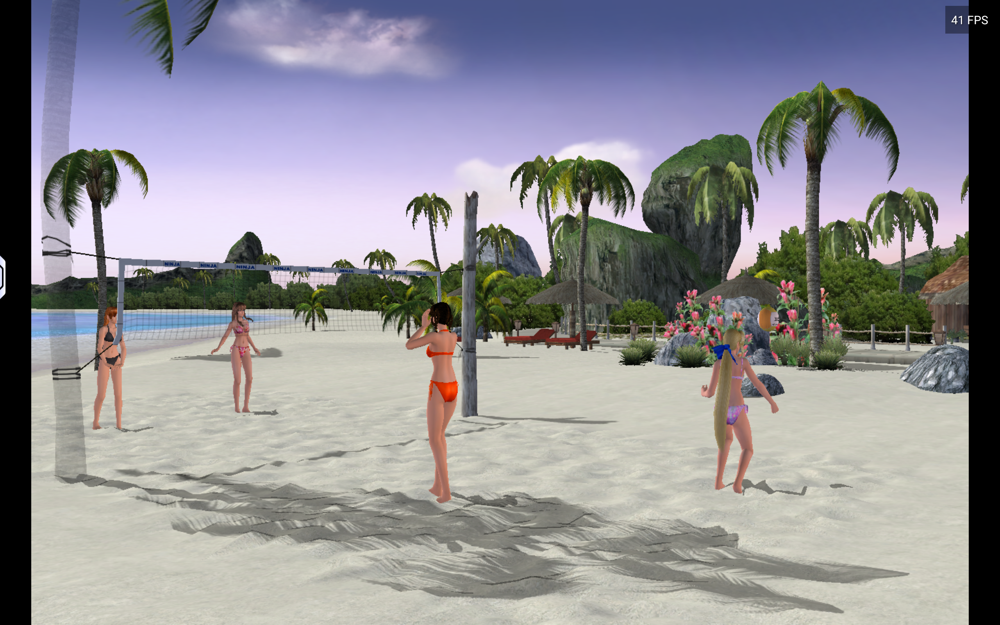
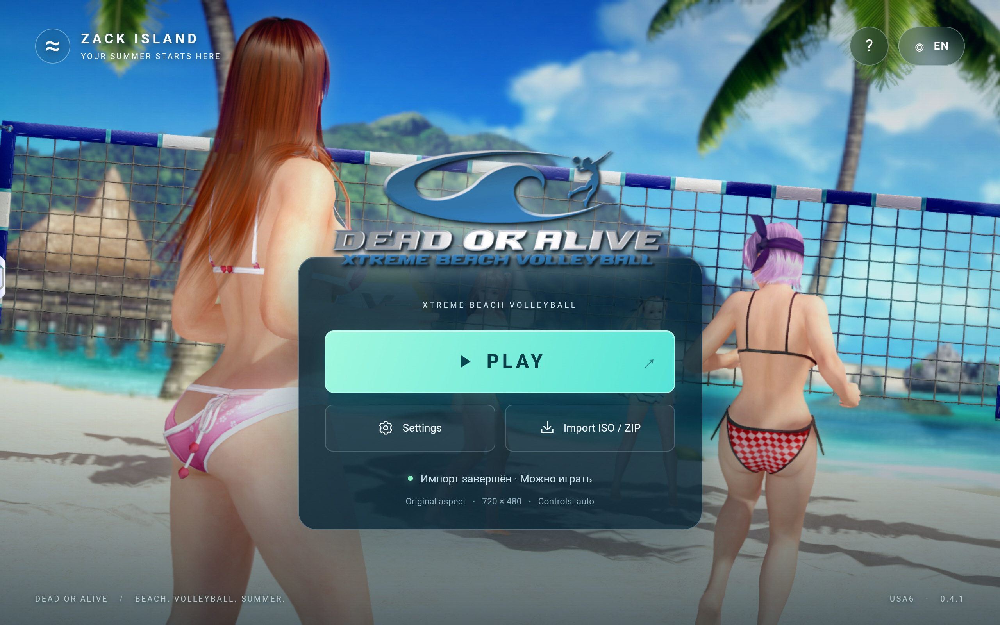
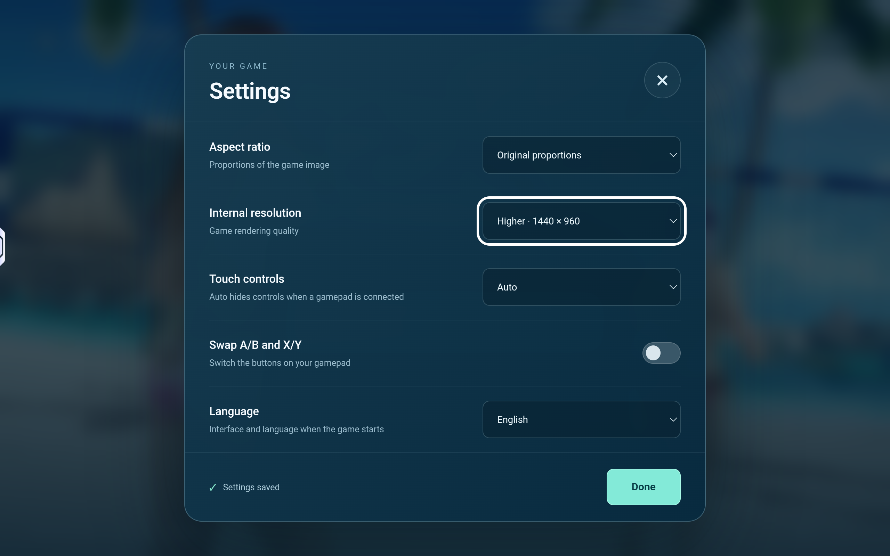
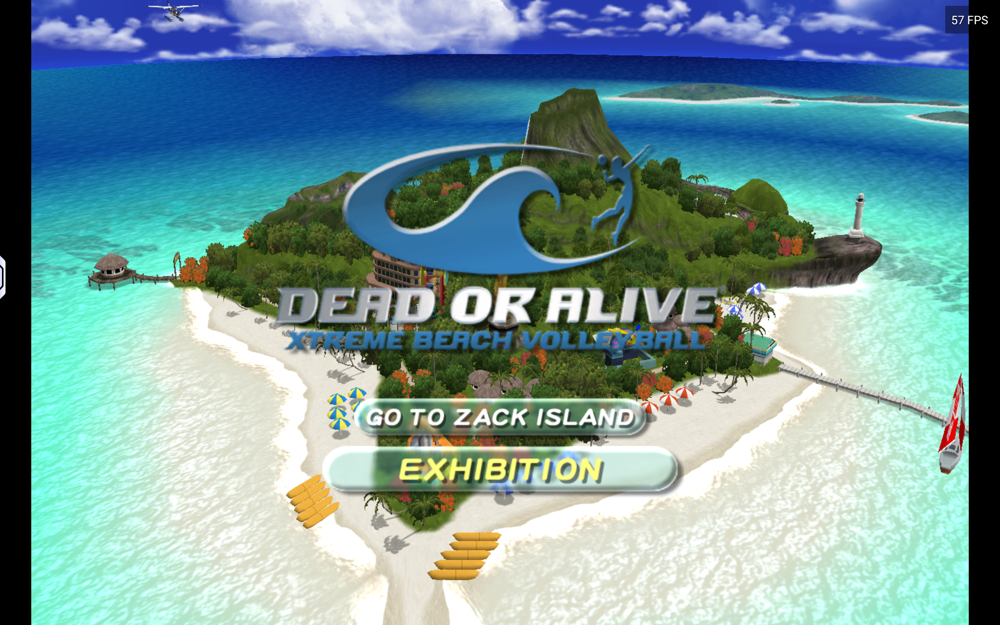
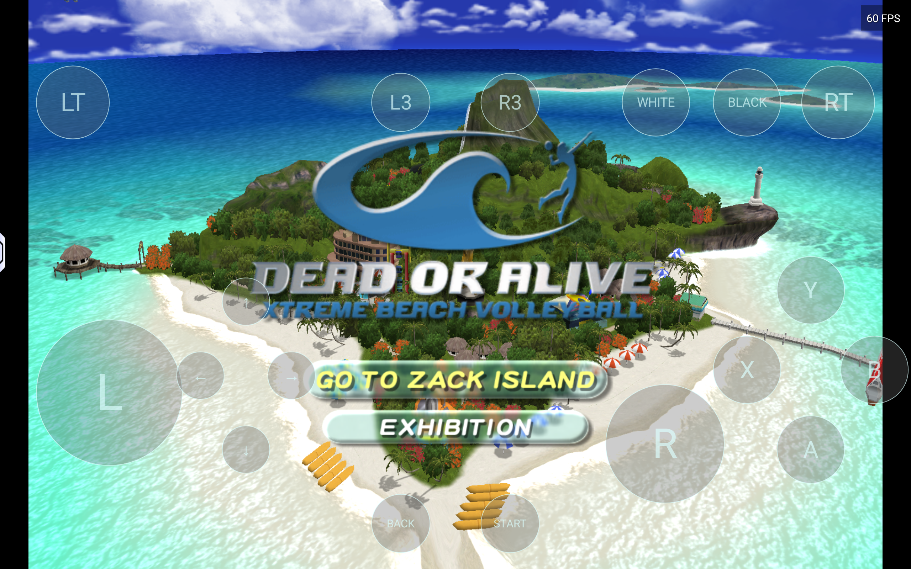

  

<h1 align="center">DOAXBV</h1>

<b>Dead or Alive Xtreme Beach Volleyball · Android</b>

  
  
  
  

<a href="README.md">Русский</a> · <b>English</b>

  <a href="https://github.com/Wannamingo/DoAXBV/releases/download/v0.4.1-ru-USA6-Beach/DOAXBV.apk"><b>Download APK</b></a> ·
  <a href="https://github.com/Wannamingo/DoAXBV/releases">All releases</a> ·
  <a href="https://github.com/Wannamingo/DoAXBV/issues/new/choose">Report a bug</a>

An unofficial Android port of **Dead or Alive Xtreme Beach Volleyball** for ARM64 devices, with touch controls, gamepad support, and importing from your own original USA game image.

An original game image is required. The ISO and complete game-data archives are not distributed in this repository.

## Versions

| Component | Version |
| --- | --- |
| Downloadable APK | `0.4.1-ru-USA6-Beach` |
| Launcher and importer | Beach 0.4.1 + USA6 ISO |
| Native core | Unchanged `0.4.0-ru-USA5` baseline |

The source consists of three layers: the **Beach interface**, the **ISO-import Java code**, and the **USA5 native core**. The native library checksum and launcher assets were checked against the APK. See [source status](docs/source-status.md) for the composition and reproducibility limits.

## APK 0.4.1 features

- Russian and English launcher interface.
- Import an original USA ISO or a supported game-data ZIP.
- Touch controls and gamepad support, with automatic hiding of touch controls when a gamepad is connected.
- Original aspect ratio, 4:3, or 16:9.
- Internal rendering resolution of 720 × 480 or 1440 × 960.
- Optional A/B and X/Y button swapping.

## Screenshots

**Volleyball**

| Beach launcher | Settings |
| --- | --- |
|  |  |

| Game main menu | Touch controls |
| --- | --- |
|  |  |

## Requirements

| Item | Requirement |
| --- | --- |
| OS | Android 8.0 or later (API 26+) |
| Architecture | ARM64 / `arm64-v8a` |
| Graphics | OpenGL ES 3.0, as declared in the APK manifest |
| Game | Original USA release of Dead or Alive Xtreme Beach Volleyball |
| Import space | At least 5 GiB of free internal storage **in addition to the ISO** |
| APK size | 51,385,934 bytes, approximately 49 MiB |

Minimum requirements do not guarantee the same performance on every device.

## Installation

1. Download **DOAXBV.apk** from the [release](https://github.com/Wannamingo/DoAXBV/releases/tag/v0.4.1-ru-USA6-Beach) and install it. If Android asks, allow installation of this APK from the selected source.
2. Copy your own **Dead or Alive Xtreme Beach Volleyball (USA) (En,Ja).iso** to the device. The image described by the supplied instructions is **7,825,162,240 bytes**. FAT32 cannot hold this file; use internal storage or exFAT.
3. Keep at least **5 GiB** of additional internal storage available for extracted game files.
4. Open DOAXBV, tap **Import ISO / ZIP**, and select the original USA ISO.
5. Keep the app open until import finishes. When the files are ready, tap **PLAY**. You may remove the ISO from the device after a successful import.

Other regions and modified game files are not supported by this build's integrity checks. If a cloud provider or file picker cannot read the ISO correctly, copy it to internal storage first.

## Controls and settings

Settings include aspect ratio, resolution, touch controls, A/B and X/Y swapping, and language. Aspect ratio, resolution, and language take effect the next time the game starts.

Gamepad mapping: **L1 → Black**, **R1 → White**, **L2/R2 → Xbox triggers**. Enable button swapping if your gamepad labels differ.

## Source and building

This repository contains the Beach launcher and ISO importer, Android backend, handwritten runtime, XBE parser, and USA5 generation recipe, with original licensing and author notices preserved.

Generated original-game code and the signing key are excluded. Rebuilding the native core requires your own original game image and local code generation. The Beach packaging script also uses a local base APK and compiled classes. This is **not a self-contained build from a clean clone**. See [source status](docs/source-status.md) and [build notes](docs/building.md).

## Issues and contributions

[Open an issue](https://github.com/Wannamingo/DoAXBV/issues/new/choose) with your APK version, device model, Android version, failing step, and reproduction steps. Do not attach the ISO, game files, signing keys, or personal information from logs.

Contributions to the public code are welcome through forks and pull requests. State which layer you changed and what you tested.

## Credits and licenses

The Android project is based on [NoRain211/doaxvb-re](https://github.com/NoRain211/doaxvb-re). Source code retains the [GNU GPL v3](LICENSE). Third-party notices are listed in [THIRD_PARTY_NOTICES.md](THIRD_PARTY_NOTICES.md).

This is an unofficial project and is not affiliated with the Dead or Alive rights holders. The game name, characters, artwork, and other original materials belong to their respective owners. The source-code license does not grant rights to original game materials.
