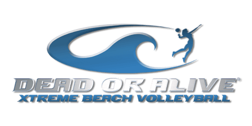
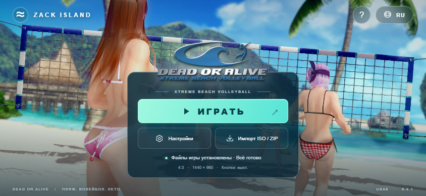

  

<h1 align="center">DOAXBV</h1>

<b>Dead or Alive Xtreme Beach Volleyball · Android</b>

  
  
  
  

<b>Русский</b> · <a href="README.en.md">English</a>

  <a href="https://github.com/Wannamingo/DoAXBV/releases/download/v0.4.1-ru-USA6-Beach/DOAXBV.apk"><b>Скачать APK</b></a> ·
  <a href="https://github.com/Wannamingo/DoAXBV/releases">Все релизы</a> ·
  <a href="https://github.com/Wannamingo/DoAXBV/issues/new/choose">Сообщить об ошибке</a>

Неофициальный Android-порт **Dead or Alive Xtreme Beach Volleyball**. Проект адаптирует игру для ARM64-устройств: с экранным управлением, поддержкой геймпада и импортом файлов из собственного образа оригинальной USA-версии.

Для запуска нужен оригинальный образ игры. ISO и полный комплект игровых данных в этом репозитории не распространяются.

## Версии

| Компонент | Версия |
| --- | --- |
| APK для скачивания | `0.4.1-ru-USA6-Beach` |
| Интерфейс и импорт | Beach 0.4.1 + USA6 ISO |
| Нативное ядро | Неизменённая база `0.4.0-ru-USA5` |

Исходники собраны из трёх частей: **Beach-интерфейс**, **Java-код импорта ISO** и **нативное ядро USA5**. Контрольная сумма нативной библиотеки и файлы интерфейса сверены с APK. Состав и пределы воспроизводимости описаны в [docs/source-status.md](docs/source-status.md).

## Возможности APK 0.4.1

- Лаунчер на русском и английском языках.
- Импорт оригинального USA ISO и поддерживаемого ZIP с игровыми файлами.
- Экранные кнопки и геймпад; автоматическое скрытие экранных кнопок при подключении геймпада.
- Исходные пропорции изображения, 4:3 или 16:9.
- Внутреннее разрешение 720 × 480 или 1440 × 960.
- Перестановка A/B и X/Y в настройках управления.

## Интерфейс

*Предпросмотр интерфейса лаунчера; не запись игрового процесса.*

## Требования

| Параметр | Требование |
| --- | --- |
| Система | Android 8.0 или новее (API 26+) |
| Архитектура | ARM64 / `arm64-v8a` |
| Графика | OpenGL ES 3.0, согласно манифесту APK |
| Игра | Оригинальная USA-версия Dead or Alive Xtreme Beach Volleyball |
| Место для импорта | Не менее 5 ГиБ во внутренней памяти **сверх места, занятого ISO** |
| Размер APK | 51 385 934 байта, примерно 49 МиБ |

Минимальные требования не гарантируют одинаковую скорость на всех устройствах.

## Установка

1. Скачайте **DOAXBV.apk** из [релиза](https://github.com/Wannamingo/DoAXBV/releases/tag/v0.4.1-ru-USA6-Beach) и установите его. Если Android запросит разрешение на установку из выбранного источника, разрешите установку этого APK.
2. Скопируйте собственный образ **Dead or Alive Xtreme Beach Volleyball (USA) (En,Ja).iso** на устройство. Для указанного в инструкции образа размер составляет **7 825 162 240 байт**. FAT32 не подходит для такого файла; используйте внутреннюю память или exFAT.
3. Оставьте не менее **5 ГиБ** свободного места во внутренней памяти для извлечённых файлов игры.
4. Откройте DOAXBV, нажмите **«Импорт ISO / ZIP»** и выберите ISO оригинальной USA-версии.
5. Оставьте приложение открытым до завершения импорта. Когда файлы будут готовы, нажмите **«ИГРАТЬ»**. После успешного импорта ISO можно удалить с устройства.

Другие регионы и изменённые игровые файлы не поддерживаются проверкой целостности этой сборки. Если выбор ISO через облачное хранилище или файловый провайдер не работает, сначала скопируйте образ во внутреннюю память.

## Управление и настройки

В меню **«Настройки»** доступны формат экрана, разрешение, экранные кнопки, перестановка A/B и X/Y, а также язык. Формат, разрешение и язык применяются при следующем запуске игры.

Для геймпада: **L1 → Black**, **R1 → White**, **L2/R2 → триггеры Xbox**. Если обозначения кнопок не совпадают, включите перестановку A/B и X/Y.

## Исходники и сборка

В репозитории опубликованы исходники Beach-лаунчера и импортера ISO, Android-бэкенд, рукописный runtime, парсер XBE и рецепт генерации нативного ядра USA5. Сохранены исходные лицензии и уведомления об авторстве.

Сгенерированный код оригинальной игры и ключ подписи исключены. Полная сборка ядра требует собственного оригинального образа и локальной генерации кода; скрипт упаковки Beach также использует локальный базовый APK и скомпилированные классы. Это **не автономный комплект сборки из чистого клона**. Подробности — в [описании исходников](docs/source-status.md) и [инструкции для разработчиков](docs/building.md).

## Ошибки и участие в разработке

Если возникла ошибка, [создайте issue](https://github.com/Wannamingo/DoAXBV/issues/new/choose). Укажите версию APK, модель устройства, версию Android, этап запуска и шаги воспроизведения. Не прикладывайте ISO, игровые данные, ключи подписи или личную информацию из журналов.

Изменения публичного кода можно предложить через fork и pull request. Укажите, какую часть проекта вы меняете и что именно проверено.

## Авторство и лицензии

Android-проект основан на [NoRain211/doaxvb-re](https://github.com/NoRain211/doaxvb-re). Исходный код сохраняет [GNU GPL v3](LICENSE); лицензии сторонних библиотек приведены в [THIRD_PARTY_NOTICES.md](THIRD_PARTY_NOTICES.md).

Проект не является официальным продуктом и не связан с правообладателями Dead or Alive. Название игры, персонажи, изображения и другие оригинальные материалы принадлежат их правообладателям. Лицензия исходного кода не распространяет права на оригинальные игровые материалы.
